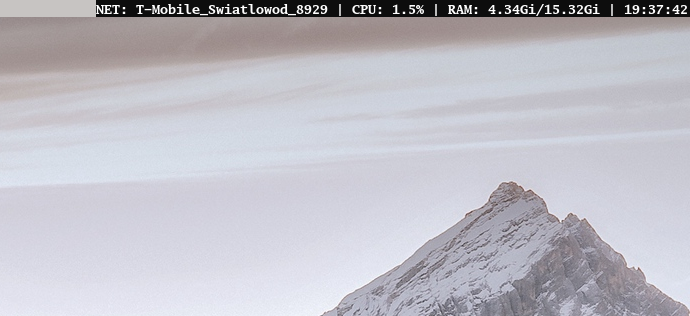

A slstatus alternative for dwl bar patch.
link to [bar patch](https://codeberg.org/dwl/dwl-patches/src/commit/9e89b5823fe19f1b43e3add89934480850a02906/patches/bar).



# Installation
```bash
git clone https://github.com/cyxap1255/dwlstatus
cd dwlstatus
make && sudo make install
```
# Uninstallation
```bash
cd dwlstatus
sudo make uninstall && sudo make clean
```
# Modules
- memory
- kernel name
- time
- battery
- cpu usage
- network (ssid) (nmcli)
- network (ssid) (wpa_supplicant)
- network (ssid) (iwctl)
- volume
- date
- more soon..

# Configuration
modules structure configuration file – modules/modules.c,
configuration file for modules displayed on the bar – dwlstatus.c

# Usage
## For dwl v0.7/v0.8 and bar patch v0.7/v0.8
you need to make a session script like this:
```bash
#!/bin/sh

[ -p /tmp/dwl-bar ] || mkfifo /tmp/dwl-bar
dwlstatus &
exec dbus-run-session dwl < /tmp/dwl-bar
```
after this add to your greetd or sddm this script as a startup script.

## For newest bar patch
just use:
```bash
dwl | dwlstatus
```

# Credits
Inspired by [suckless slstatus](https://github.com/drkhsh/slstatus).
